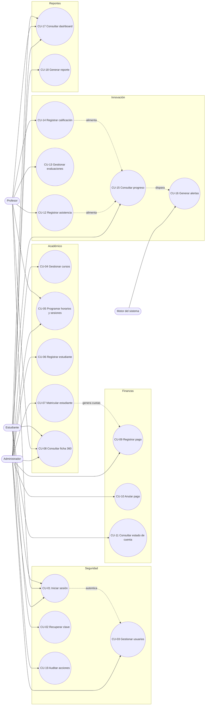

# 4. Casos de uso

## 4.1 Actores

| Actor | Tipo | Descripción |
|---|---|---|
| Administrador | Humano | Coordina la academia: usuarios, oferta académica, matrículas, pagos y reportes. |
| Profesor | Humano | Gestiona asistencia, evaluaciones y notas de sus cursos. |
| Estudiante | Humano | Consulta su progreso, asistencia, pagos y alertas. |
| Sistema (motor) | Sistema | Genera cuotas, calcula porcentajes, crea alertas y registra auditoría. |

## 4.2 Diagrama general

## 4.3 Inventario de casos de uso

| CU | Nombre | Actor primario | HU | RF |
|---|---|---|---|---|
| CU-01 | Iniciar sesión | Todos | HU-01 | RF-01, 02 |
| CU-02 | Recuperar contraseña | Todos | HU-02 | RF-03 |
| CU-03 | Gestionar usuarios y roles | Administrador | HU-03, 04 | RF-05, 06, 07 |
| CU-04 | Gestionar cursos y profesores | Administrador | HU-07 | RF-10, 11, 13, 16 |
| CU-05 | Programar horarios y sesiones | Administrador | HU-08, 09 | RF-12, 14, 15 |
| CU-06 | Registrar estudiante | Administrador | HU-10 | RF-17, 23 |
| CU-07 | Matricular estudiante | Administrador | HU-11, 14 | RF-19, 20, 21 |
| CU-08 | Consultar ficha 360° | Admin/Profesor | HU-12 | RF-18 |
| CU-09 | Registrar pago | Administrador | HU-15 | RF-24, 25, 28 |
| CU-10 | Anular pago | Administrador | HU-17 | RF-26 |
| CU-11 | Consultar estado de cuenta | Admin/Estudiante | HU-16 | RF-27 |
| CU-12 | Registrar asistencia | Profesor | HU-19 | RF-31, 32, 33 |
| CU-13 | Gestionar evaluaciones | Profesor | HU-20 | RF-34 |
| CU-14 | Registrar calificación | Profesor | HU-21 | RF-35 |
| CU-15 | Consultar progreso | Estudiante | HU-22 | RF-36 |
| CU-16 | Generar alertas | Sistema | HU-23, 24 | RF-37, 38, 39 |
| CU-17 | Consultar dashboard | Todos | HU-25, 26, 27 | RF-40 |
| CU-18 | Generar reporte y exportar | Administrador | HU-28, 29 | RF-41 a 45 |
| CU-19 | Auditar acciones | Administrador | HU-05 | RF-08, 44 |

---

## CU-01 · Iniciar sesión

| Campo | Detalle |
|---|---|
| **Actor** | Administrador, Profesor, Estudiante |
| **Objetivo** | Autenticar al usuario y habilitar las funciones de su rol. |
| **Precondiciones** | Usuario registrado y ACTIVO; base de datos disponible. |
| **Disparador** | El usuario envía el formulario de login. |

**Flujo principal**

1. El usuario abre `GET /login` y recibe el formulario con token CSRF.
2. Ingresa correo y contraseña; JavaScript valida formato y envía `POST /login` (Fetch si hay JS, formulario si no).
3. El Front Controller enruta a `AuthController::login`.
4. El controlador valida CSRF, campos y throttling de intentos.
5. `Usuario::findByEmail()` consulta con PDO y `prepare()`.
6. El controlador verifica `password_verify()` y el estado ACTIVO.
7. Si es válido: `session_regenerate_id(true)`, guarda usuario/rol/permisos, actualiza `ultimo_login`, audita `LOGIN` y responde redirección al dashboard.
8. El dashboard se renderiza según el rol.

**Flujos alternativos**

- **A1. Petición AJAX:** el servidor responde `{ok:true, redirect:"..."}` y el JS navega; si hay error, `{ok:false, errors:{...}}` y se muestran junto al campo.
- **A2. Usuario ya autenticado:** `GET /login` redirige al dashboard sin mostrar el formulario.

**Excepciones**

- **E1. Credenciales inválidas:** mensaje genérico, incremento del contador de intentos y auditoría `LOGIN_FALLIDO`.
- **E2. Usuario inactivo/bloqueado:** se rechaza con mensaje controlado; se audita.
- **E3. CSRF inválido:** HTTP 419 y registro de seguridad.
- **E4. 5 intentos fallidos:** bloqueo temporal de 15 minutos.
- **E5. Error de BD:** se registra en el log y se muestra mensaje genérico 500.

**Postcondiciones:** sesión creada con ID regenerado; `ultimo_login` actualizado; evento auditado.

---

## CU-07 · Matricular estudiante y generar cuotas

| Campo | Detalle |
|---|---|
| **Actor** | Administrador |
| **Objetivo** | Vincular un estudiante a un curso y crear su plan de pagos. |
| **Precondiciones** | Estudiante ACTIVO; curso PLANIFICADO o EN_CURSO con cupo; sesión de administrador. |
| **Disparador** | El administrador confirma la matrícula. |

**Flujo principal**

1. El administrador abre la ficha del estudiante y elige «Matricular».
2. El sistema lista cursos con cupo disponible y su valor.
3. Selecciona curso, valor total, número de cuotas y fecha de primer vencimiento.
4. El controlador valida CSRF, permisos y datos.
5. `Matricula::crear()` abre una transacción.
6. Verifica duplicidad (`estudiante_id`, `curso_id`, estado ACTIVA) y cupo con `SELECT ... FOR UPDATE` sobre el curso.
7. Inserta la matrícula y calcula las cuotas: `valorCuota = floor(total / n)` y la última absorbe el residuo.
8. Inserta las N cuotas con vencimientos mensuales.
9. Confirma la transacción y audita `CREAR_MATRICULA`.
10. Redirige a la ficha con mensaje de éxito y el plan de pagos visible.

**Alternativas**

- **A1. Curso lleno:** se rechaza y se sugiere otro curso del mismo nivel.
- **A2. Matrícula duplicada:** se informa la matrícula existente y se enlaza a ella.

**Excepciones**

- **E1. Falla al insertar una cuota:** rollback total; no queda matrícula huérfana.
- **E2. Número de cuotas inválido (0 o > 24):** error de validación.
- **E3. Valor total ≤ 0:** error de validación.

**Postcondiciones:** matrícula ACTIVA; cuotas PENDIENTE; cupo ocupado; evento auditado; saldo inicial igual al valor total.

---

## CU-09 · Registrar pago

| Campo | Detalle |
|---|---|
| **Actor** | Administrador |
| **Objetivo** | Registrar el pago de una cuota y actualizar el estado de cuenta. |
| **Precondiciones** | Matrícula ACTIVA con cuota PENDIENTE; sesión de administrador. |
| **Disparador** | El administrador confirma el pago recibido. |

**Flujo principal**

1. El administrador busca al estudiante y abre su estado de cuenta.
2. Selecciona la cuota, ingresa valor, método, referencia y fecha.
3. El controlador valida CSRF, permisos, valor > 0 y que no supere el saldo.
4. `Pago::registrar()` inicia transacción.
5. Bloquea la cuota (`FOR UPDATE`), calcula el saldo actual y valida de nuevo.
6. Inserta el pago REGISTRADO con `registrado_por`.
7. Si el pago cubre el saldo, actualiza la cuota a PAGADA.
8. Confirma, audita `CREAR_PAGO` y redirige al comprobante.

**Alternativas**

- **A1. Pago parcial:** la cuota sigue PENDIENTE con saldo restante; el comprobante lo indica.
- **A2. Pago de matrícula sin cuota:** se permite con `cuota_id = NULL` y concepto MATRICULA.

**Excepciones**

- **E1. Valor mayor al saldo:** rechazo con el saldo disponible.
- **E2. Cuota ya pagada:** rechazo; se sugiere anular el pago previo.
- **E3. Falla de BD:** rollback y mensaje genérico.

**Postcondiciones:** pago REGISTRADO; cuota actualizada; ingresos reflejados; comprobante disponible; evento auditado.

---

## CU-12 · Registrar asistencia por sesión

| Campo | Detalle |
|---|---|
| **Actor** | Profesor |
| **Objetivo** | Registrar la asistencia real de una sesión de clase. |
| **Precondiciones** | Curso asignado al profesor; sesión PROGRAMADA o DICTADA; matrículas ACTIVAS. |
| **Disparador** | El profesor abre la sesión y pulsa «Tomar asistencia». |

**Flujo principal**

1. El profesor abre su agenda y selecciona la sesión.
2. El sistema valida que el curso le pertenece.
3. Muestra la lista de estudiantes activos con PRESENTE por defecto.
4. El profesor ajusta AUSENTE, TARDE o EXCUSA y agrega observación si aplica.
5. Al guardar, el controlador valida CSRF y permisos.
6. `Asistencia::guardarSesion()` inicia transacción y usa `INSERT ... ON DUPLICATE KEY UPDATE` por (sesión, matrícula).
7. Marca la sesión como DICTADA.
8. Confirma, audita y muestra el resumen: presentes, ausentes y tardanzas.

**Alternativas**

- **A1. Edición dentro de 24 h:** permitida al profesor; fuera de la ventana, solo administrador.
- **A2. Sesión cancelada:** no admite asistencia.
- **A3. Estudiante retirado:** no aparece en la lista.

**Excepciones**

- **E1. Curso ajeno:** HTTP 403 y auditoría.
- **E2. Sesión inexistente:** 404.
- **E3. Falla parcial:** rollback; no se guarda asistencia incompleta.

**Postcondiciones:** asistencias registradas; porcentajes recalculados por vista; sesión DICTADA; evento auditado.

---

## CU-15 · Consultar progreso académico

| Campo | Detalle |
|---|---|
| **Actor** | Estudiante (también Admin/Profesor) |
| **Objetivo** | Conocer promedio ponderado, avance y asistencia del curso. |
| **Precondiciones** | Matrícula ACTIVA o FINALIZADA con evaluaciones definidas. |
| **Disparador** | El usuario abre «Mi progreso». |

**Flujo principal**

1. El controlador obtiene la matrícula del estudiante autenticado.
2. Consulta la vista `vw_progreso_estudiante`: pesos calificados, promedio ponderado y avance.
3. Consulta `vw_asistencia_estudiante`: presentes, ausentes y porcentaje.
4. Consulta las próximas evaluaciones y entregas pendientes.
5. La vista muestra tarjetas, barra de avance y tabla de evaluaciones.
6. Si el promedio < 3.0 o la asistencia < 80 %, se resalta una advertencia.

**Alternativas**

- **A1. Sin notas:** avance 0 %, promedio «—» y mensaje «Aún no hay calificaciones».
- **A2. Sin sesiones:** asistencia «Sin datos».

**Excepciones**

- **E1. Estudiante sin matrícula:** estado vacío con enlace a admisiones.
- **E2. Acceso a matrícula ajena:** 403.

**Postcondiciones:** solo lectura; se registra consulta en auditoría si es sensible (opcional).

**Fórmulas**

- `avance% = (Σ peso de evaluaciones calificadas / Σ peso de todas las evaluaciones) × 100`
- `promedio = Σ(nota × peso) / Σ(peso de evaluaciones calificadas)`
- `asistencia% = (sesiones − ausentes) / sesiones × 100`

---

## CU-16 · Generar alertas automáticas

| Campo | Detalle |
|---|---|
| **Actor** | Sistema (invocado por cron, login o acción del administrador) |
| **Objetivo** | Crear notificaciones accionables y no duplicadas. |
| **Precondiciones** | Datos de evaluaciones, cuotas, notas y asistencia disponibles. |
| **Disparador** | Ejecución programada diaria (07:00 America/Bogota) o manual desde el dashboard. |

**Flujo principal**

1. El motor busca evaluaciones con `fecha_entrega` entre hoy y hoy + 7 días.
2. Para cada matrícula ACTIVA del curso, crea alerta tipo EVALUACION si no existe una equivalente vigente.
3. Busca evaluaciones vencidas sin calificación y alerta al profesor.
4. Calcula promedio por matrícula; si < 3.0 crea alerta RENDIMIENTO.
5. Calcula asistencia; si < 80 % crea alerta ASISTENCIA.
6. Busca cuotas vencidas con saldo; crea alerta PAGO para estudiante y administrador.
7. Inserta las alertas en una transacción y registra cuántas creó.
8. Devuelve el resumen al invocador.

**Alternativas**

- **A1. Sin novedades:** no inserta nada y registra «0 alertas».
- **A2. Alerta ya existente:** se omite (deduplicación por usuario, tipo y referencia).

**Excepciones**

- **E1. Falla de BD:** rollback y log; el motor puede reintentarse sin duplicar.
- **E2. Curso sin evaluaciones:** se omite sin error.

**Postcondiciones:** alertas visibles en el centro de notificaciones; contadores actualizados; ejecución auditada.
