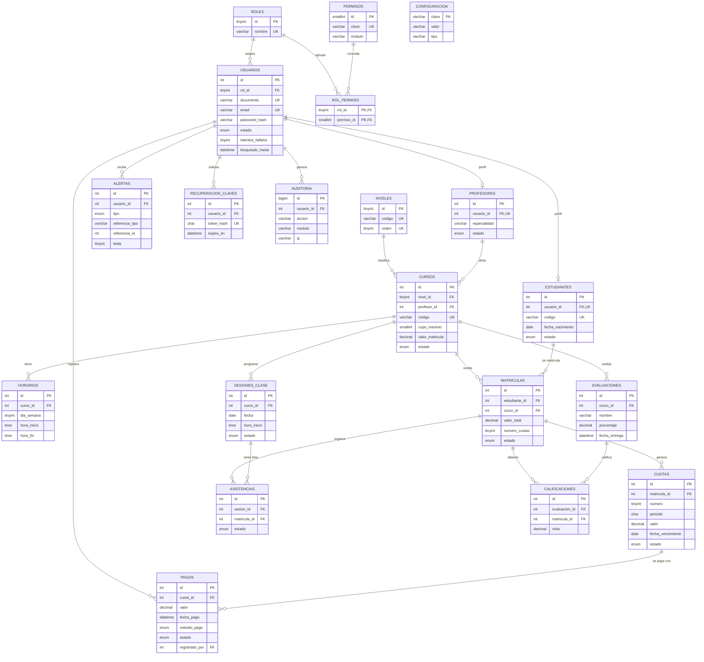

# 7. Modelo de datos

## 7.1 Motor y convenciones

- **SGBD:** MySQL 8.0 / MariaDB 10.4+ (probado en MariaDB 10.4.32 de XAMPP).
- **Base de datos:** `anglish`, charset `utf8mb4`, collation `utf8mb4_unicode_ci`, motor InnoDB.
- **Nomenclatura:** tablas y columnas en `snake_case`, singular; PK `id`; FK `<entidad>_id`; fechas `created_at`/`updated_at`.
- **Integridad:** llaves foráneas, `CHECK`, `UNIQUE`, `ENUM` para dominios cerrados y transacciones para pagos/matrículas.
- **Dinero:** `DECIMAL(12,2)` en COP. **Notas:** `DECIMAL(2,1)` de 1.0 a 5.0.
- **Borrado lógico:** usuarios, matrículas, pagos y cursos usan estados; no se elimina historia académica ni financiera.

## 7.2 Diagrama entidad-relación (EER)

## 7.3 Normalización (1FN, 2FN, 3FN)

### Primera forma normal (1FN)

Todos los atributos son atómicos y no hay grupos repetidos:

- Un estudiante por fila en `usuarios`/`estudiantes`; sus teléfonos no se guardan como listas separadas por comas.
- La relación estudiante-curso se resuelve en `matriculas` (una fila por vínculo).
- La relación sesión-estudiante se resuelve en `asistencias`, no en columnas `presente1`, `presente2`, etc.
- Los horarios se guardan una fila por día en `horarios`, no como texto `"Lun/Mié 7-9"`.

### Segunda forma normal (2FN)

Todas las tablas tienen PK simple (`id`) y las claves únicas compuestas solo refuerzan reglas; ningún atributo depende de parte de una clave:

- `asistencias` tiene PK `id` y `UNIQUE(sesion_id, matricula_id)`. El estado depende de la pareja completa, no solo de la sesión.
- `calificaciones` tiene PK `id` y `UNIQUE(evaluacion_id, matricula_id)`. La nota depende de ambas.
- `rol_permiso` es la única tabla con PK compuesta y sus dos columnas son la clave; no tiene atributos no clave.

### Tercera forma normal (3FN)

No existen dependencias transitivas:

- `cursos` guarda `nivel_id` y `profesor_id`, no el nombre del nivel ni el del profesor.
- `matriculas` guarda `estudiante_id` y `curso_id`, no nombres, correos ni valores duplicados.
- `pagos` guarda `cuota_id`; el estudiante y el curso se derivan con `cuota → matrícula → estudiante/curso`.
- `calificaciones` guarda `evaluacion_id` y `matricula_id`; no repite el nombre de la evaluación.
- Los totales (saldo, promedio, porcentaje de asistencia) **no se almacenan**: se calculan en vistas para evitar redundancia y anomalías de actualización.

**Atributos de estado:** `estado` en matrículas, cuotas y pagos representa el ciclo de vida del registro (ACTIVA/RETIRADA, PENDIENTE/PAGADA/ANULADA, REGISTRADO/ANULADO). No es un cálculo derivado: es un dato que cambia por una acción de negocio y se mantiene dentro de una transacción. El saldo y los totales sí se calculan.

### Integridad referencial y reglas de borrado

| Relación | ON DELETE | Justificación |
|---|---|---|
| `rol_permiso → roles/permisos` | CASCADE | Tabla puente sin historia propia. |
| `usuarios → roles` | RESTRICT | No se elimina un rol con usuarios. |
| `estudiantes/profesores → usuarios` | CASCADE | El perfil no existe sin usuario; la app inactiva, no borra. |
| `cursos → niveles/profesores` | RESTRICT | No se borra un nivel/profesor con cursos. |
| `matriculas → estudiantes/cursos` | RESTRICT | La matrícula es historia académica. |
| `cuotas → matriculas` | CASCADE | Las cuotas pertenecen a la matrícula. |
| `pagos → cuotas` | RESTRICT | Un pago con historia no se borra; se anula. |
| `asistencias/calificaciones → matrículas` | CASCADE | Registros dependientes de la matrícula. |
| `auditoria → usuarios` | SET NULL | La auditoría sobrevive aunque el usuario se elimine. |
| `alertas/recuperacion → usuarios` | CASCADE | Datos operativos del usuario. |

## 7.4 Diccionario de datos

### `roles`

| Campo | Tipo | Restricción | Descripción |
|---|---|---|---|
| `id` | TINYINT UNSIGNED | PK, AUTO_INCREMENT | Identificador. |
| `nombre` | VARCHAR(30) | UNIQUE, NOT NULL | ADMINISTRADOR, PROFESOR, ESTUDIANTE. |
| `descripcion` | VARCHAR(150) | NULL | Propósito del rol. |

### `permisos`

| Campo | Tipo | Restricción | Descripción |
|---|---|---|---|
| `id` | SMALLINT UNSIGNED | PK | Identificador. |
| `clave` | VARCHAR(60) | UNIQUE, NOT NULL | Ej. `pagos.crear`. |
| `descripcion` | VARCHAR(150) | NOT NULL | Acción permitida. |
| `modulo` | VARCHAR(40) | NOT NULL | Agrupación para el menú. |

### `rol_permiso`

| Campo | Tipo | Restricción | Descripción |
|---|---|---|---|
| `rol_id` | TINYINT UNSIGNED | PK, FK → roles | Rol. |
| `permiso_id` | SMALLINT UNSIGNED | PK, FK → permisos | Permiso concedido. |

### `usuarios`

| Campo | Tipo | Restricción | Descripción |
|---|---|---|---|
| `id` | INT UNSIGNED | PK | Identificador. |
| `rol_id` | TINYINT UNSIGNED | FK → roles, NOT NULL | Rol principal (RBAC). |
| `nombres`, `apellidos` | VARCHAR(80) | NOT NULL | Nombre completo. |
| `documento` | VARCHAR(20) | UNIQUE, NOT NULL | Cédula/TI. |
| `email` | VARCHAR(120) | UNIQUE, NOT NULL | Usuario de acceso. |
| `password_hash` | VARCHAR(255) | NOT NULL | Hash bcrypt; nunca texto plano. |
| `telefono` | VARCHAR(20) | NULL | Contacto. |
| `estado` | ENUM | ACTIVO/INACTIVO/BLOQUEADO | Ciclo de vida. |
| `intentos_fallidos` | TINYINT UNSIGNED | DEFAULT 0 | Throttling de login. |
| `bloqueado_hasta` | DATETIME | NULL | Fin del bloqueo temporal. |
| `ultimo_login` | DATETIME | NULL | Último acceso exitoso. |
| `created_at`, `updated_at` | TIMESTAMP | DEFAULT CURRENT_TIMESTAMP | Auditoría temporal. |

### `estudiantes`

| Campo | Tipo | Restricción | Descripción |
|---|---|---|---|
| `id` | INT UNSIGNED | PK | Identificador. |
| `usuario_id` | INT UNSIGNED | FK, UNIQUE | Usuario asociado. |
| `codigo` | VARCHAR(20) | UNIQUE | Código legible (EST-2026-001). |
| `fecha_nacimiento` | DATE | NOT NULL | Edad y reglas de acudiente. |
| `acudiente`, `telefono_acudiente` | VARCHAR | NULL | Contacto del acudiente. |
| `fecha_ingreso` | DATE | NOT NULL | Ingreso a la academia. |
| `estado` | ENUM | ACTIVO/RETIRADO/EGRESADO | Situación actual. |
| `observaciones` | TEXT | NULL | Notas administrativas. |

### `profesores`

| Campo | Tipo | Restricción | Descripción |
|---|---|---|---|
| `id` | INT UNSIGNED | PK | Identificador. |
| `usuario_id` | INT UNSIGNED | FK, UNIQUE | Usuario asociado. |
| `especialidad` | VARCHAR(100) | NOT NULL | Área de enseñanza. |
| `titulo` | VARCHAR(120) | NULL | Formación académica. |
| `fecha_contratacion` | DATE | NOT NULL | Vinculación. |
| `estado` | ENUM | ACTIVO/INACTIVO | Disponibilidad. |

### `niveles`

| Campo | Tipo | Restricción | Descripción |
|---|---|---|---|
| `id` | TINYINT UNSIGNED | PK | Identificador. |
| `codigo` | VARCHAR(2) | UNIQUE | A1, A2, B1, B2, C1. |
| `nombre` | VARCHAR(50) | NOT NULL | Nombre del nivel. |
| `descripcion` | VARCHAR(255) | NULL | Competencias. |
| `orden` | TINYINT UNSIGNED | UNIQUE | Secuencia MCER. |
| `horas` | SMALLINT UNSIGNED | NOT NULL | Intensidad horaria. |

### `cursos`

| Campo | Tipo | Restricción | Descripción |
|---|---|---|---|
| `id` | INT UNSIGNED | PK | Identificador. |
| `nivel_id` | TINYINT UNSIGNED | FK → niveles | Nivel MCER. |
| `profesor_id` | INT UNSIGNED | FK → profesores | Profesor titular. |
| `codigo` | VARCHAR(20) | UNIQUE | Ej. ING-A1-01. |
| `nombre` | VARCHAR(100) | NOT NULL | Nombre comercial. |
| `jornada` | ENUM | MAÑANA/TARDE/NOCHE/SABATINA | Franja. |
| `aula` | VARCHAR(30) | NULL | Espacio físico. |
| `cupo_maximo` | SMALLINT UNSIGNED | CHECK > 0 | Capacidad. |
| `fecha_inicio`, `fecha_fin` | DATE | CHECK fin > inicio | Vigencia. |
| `valor_matricula` | DECIMAL(12,2) | CHECK >= 0 | Precio base. |
| `estado` | ENUM | PLANIFICADO/EN_CURSO/FINALIZADO/CANCELADO | Ciclo de vida. |

### `horarios`

| Campo | Tipo | Restricción | Descripción |
|---|---|---|---|
| `id` | INT UNSIGNED | PK | Identificador. |
| `curso_id` | INT UNSIGNED | FK → cursos | Curso. |
| `dia_semana` | TINYINT | CHECK 1–7 | 1 = lunes … 7 = domingo. |
| `hora_inicio`, `hora_fin` | TIME | CHECK fin > inicio | Franja de clase. |
| `aula` | VARCHAR(30) | NULL | Aula específica del día. |
| — | — | UNIQUE(curso_id, dia_semana, hora_inicio) | Evita duplicados. |

### `matriculas`

| Campo | Tipo | Restricción | Descripción |
|---|---|---|---|
| `id` | INT UNSIGNED | PK | Identificador. |
| `estudiante_id` | INT UNSIGNED | FK → estudiantes | Alumno. |
| `curso_id` | INT UNSIGNED | FK → cursos | Curso. |
| `fecha_matricula` | DATE | NOT NULL | Fecha de vinculación. |
| `valor_total` | DECIMAL(12,2) | CHECK > 0 | Valor pactado. |
| `numero_cuotas` | TINYINT UNSIGNED | CHECK 1–24 | Plan de pagos. |
| `estado` | ENUM | ACTIVA/RETIRADA/FINALIZADA | Situación. |
| `motivo_retiro` | VARCHAR(255) | NULL | Justificación. |
| `retirada_por`, `retirada_en` | FK/DATETIME | NULL | Trazabilidad del retiro. |
| — | — | UNIQUE(estudiante_id, curso_id) | Una matrícula por curso. |

### `cuotas`

| Campo | Tipo | Restricción | Descripción |
|---|---|---|---|
| `id` | INT UNSIGNED | PK | Identificador. |
| `matricula_id` | INT UNSIGNED | FK → matriculas | Obligación. |
| `numero` | TINYINT UNSIGNED | UNIQUE(matricula_id, numero) | Consecutivo. |
| `concepto` | ENUM | MATRICULA/MENSUALIDAD/CERTIFICADO/OTRO | Tipo de cobro. |
| `periodo` | CHAR(7) | NOT NULL | `YYYY-MM`. |
| `valor` | DECIMAL(12,2) | CHECK > 0 | Valor de la cuota. |
| `fecha_vencimiento` | DATE | NOT NULL | Vencimiento. |
| `estado` | ENUM | PENDIENTE/PAGADA/ANULADA | Estado de la obligación. |

### `pagos`

| Campo | Tipo | Restricción | Descripción |
|---|---|---|---|
| `id` | BIGINT UNSIGNED | PK | Identificador. |
| `cuota_id` | INT UNSIGNED | FK → cuotas | Cuota pagada. |
| `valor` | DECIMAL(12,2) | CHECK > 0 | Monto recibido. |
| `fecha_pago` | DATETIME | NOT NULL | Fecha y hora. |
| `metodo_pago` | ENUM | EFECTIVO/TRANSFERENCIA/TARJETA/NEQUI/DAVIPLATA | Medio. |
| `referencia` | VARCHAR(60) | NULL | Soporte bancario. |
| `estado` | ENUM | REGISTRADO/ANULADO | Vigencia. |
| `motivo_anulacion` | VARCHAR(255) | NULL | Obligatorio al anular. |
| `registrado_por` | INT UNSIGNED | FK → usuarios | Responsable. |
| `anulado_por`, `anulado_en` | FK/DATETIME | NULL | Trazabilidad de anulación. |

### `sesiones_clase`

| Campo | Tipo | Restricción | Descripción |
|---|---|---|---|
| `id` | INT UNSIGNED | PK | Identificador. |
| `curso_id` | INT UNSIGNED | FK → cursos | Curso. |
| `fecha` | DATE | NOT NULL | Día de clase. |
| `hora_inicio`, `hora_fin` | TIME | CHECK fin > inicio | Franja. |
| `tema` | VARCHAR(150) | NOT NULL | Contenido. |
| `estado` | ENUM | PROGRAMADA/DICTADA/CANCELADA | Situación. |
| `creado_por` | INT UNSIGNED | FK → usuarios | Responsable. |
| — | — | UNIQUE(curso_id, fecha, hora_inicio) | Evita duplicados. |

### `asistencias`

| Campo | Tipo | Restricción | Descripción |
|---|---|---|---|
| `id` | BIGINT UNSIGNED | PK | Identificador. |
| `sesion_id` | INT UNSIGNED | FK → sesiones_clase | Sesión. |
| `matricula_id` | INT UNSIGNED | FK → matriculas | Estudiante. |
| `estado` | ENUM | PRESENTE/AUSENTE/TARDE/EXCUSA | Resultado. |
| `observacion` | VARCHAR(200) | NULL | Nota del profesor. |
| `registrado_por` | INT UNSIGNED | FK → usuarios | Quién tomó lista. |
| — | — | UNIQUE(sesion_id, matricula_id) | Una marca por estudiante/sesión. |

### `evaluaciones`

| Campo | Tipo | Restricción | Descripción |
|---|---|---|---|
| `id` | INT UNSIGNED | PK | Identificador. |
| `curso_id` | INT UNSIGNED | FK → cursos | Curso. |
| `nombre` | VARCHAR(100) | NOT NULL | Nombre. |
| `tipo` | ENUM | TALLER/QUIZ/PARCIAL/PROYECTO/EXAMEN_FINAL | Tipo. |
| `porcentaje` | DECIMAL(5,2) | CHECK 0 < x ≤ 100 | Peso en la nota. |
| `fecha_entrega` | DATETIME | NOT NULL | Fecha límite. |
| `descripcion` | TEXT | NULL | Instrucciones. |
| `estado` | ENUM | PROGRAMADA/ABIERTA/CERRADA | Ciclo. |
| — | — | UNIQUE(curso_id, nombre) | Evita duplicados. |

### `calificaciones`

| Campo | Tipo | Restricción | Descripción |
|---|---|---|---|
| `id` | BIGINT UNSIGNED | PK | Identificador. |
| `evaluacion_id` | INT UNSIGNED | FK → evaluaciones | Evaluación. |
| `matricula_id` | INT UNSIGNED | FK → matriculas | Estudiante. |
| `nota` | DECIMAL(2,1) | CHECK 1.0–5.0 | Calificación. |
| `observacion` | VARCHAR(200) | NULL | Retroalimentación. |
| `registrado_por` | INT UNSIGNED | FK → usuarios | Profesor. |
| — | — | UNIQUE(evaluacion_id, matricula_id) | Una nota por evaluación. |

### `alertas`

| Campo | Tipo | Restricción | Descripción |
|---|---|---|---|
| `id` | BIGINT UNSIGNED | PK | Identificador. |
| `usuario_id` | INT UNSIGNED | FK → usuarios | Destinatario. |
| `tipo` | ENUM | EVALUACION/PAGO/ASISTENCIA/RENDIMIENTO | Categoría. |
| `titulo`, `mensaje` | VARCHAR | NOT NULL | Contenido. |
| `referencia_tipo` | ENUM | evaluacion/cuota/matricula | Origen. |
| `referencia_id` | INT UNSIGNED | NOT NULL | Id del origen. |
| `fecha_evento` | DATETIME | NULL | Fecha del evento. |
| `leida` | TINYINT(1) | DEFAULT 0 | Estado de lectura. |
| — | — | UNIQUE(usuario_id, tipo, referencia_tipo, referencia_id) | Deduplicación. |

### `recuperacion_claves`

| Campo | Tipo | Restricción | Descripción |
|---|---|---|---|
| `id` | INT UNSIGNED | PK | Identificador. |
| `usuario_id` | INT UNSIGNED | FK → usuarios | Solicitante. |
| `token_hash` | CHAR(64) | UNIQUE | SHA-256 del token (nunca el token en claro). |
| `expira_en` | DATETIME | NOT NULL | Vigencia de 30 minutos. |
| `usado_en` | DATETIME | NULL | Marca de un solo uso. |

### `auditoria`

| Campo | Tipo | Restricción | Descripción |
|---|---|---|---|
| `id` | BIGINT UNSIGNED | PK | Identificador. |
| `usuario_id` | INT UNSIGNED | FK → usuarios, SET NULL | Autor. |
| `accion` | VARCHAR(30) | NOT NULL | LOGIN, CREAR, ANULAR, etc. |
| `modulo` | VARCHAR(40) | NOT NULL | Módulo afectado. |
| `descripcion` | VARCHAR(255) | NULL | Detalle legible. |
| `ip` | VARCHAR(45) | NULL | IPv4/IPv6. |
| `user_agent` | VARCHAR(255) | NULL | Navegador. |
| `created_at` | TIMESTAMP | DEFAULT CURRENT_TIMESTAMP | Fecha del evento. |

### `configuracion`

| Campo | Tipo | Restricción | Descripción |
|---|---|---|---|
| `clave` | VARCHAR(50) | PK | Ej. `academia.nombre`. |
| `valor` | VARCHAR(255) | NOT NULL | Valor. |
| `tipo` | ENUM | TEXTO/NUMERO/BOOLEAN/JSON | Interpretación. |
| `descripcion` | VARCHAR(150) | NULL | Ayuda. |
| `updated_at` | TIMESTAMP | ON UPDATE | Última modificación. |

## 7.5 Vistas de cálculo

| Vista | Propósito | Fórmula / regla |
|---|---|---|
| `vw_estudiantes` | Datos planos para listados y filtros. | JOIN usuarios + estudiantes. |
| `vw_cursos_detalle` | Curso con nivel, profesor, matriculados y cupo disponible. | Subconsulta de matrículas ACTIVAS. |
| `vw_estado_cuenta` | Total, pagado, saldo y estado de cartera por matrícula. | `saldo = valor_total − Σ pagos REGISTRADOS`; EN MORA si hay cuota vencida con saldo. |
| `vw_asistencia_estudiante` | Sesiones, presentes, ausentes y porcentaje. | `(sesiones − ausentes) / sesiones × 100`, 1 decimal. |
| `vw_progreso_estudiante` | Peso calificado, avance y promedio ponderado. | `Σ(nota×peso)/Σ(peso calificado)`; avance `Σ peso calificado / Σ peso total`. |
| `vw_ingresos_mensuales` | Ingresos, anulados y neto por mes. | Agrupa `pagos` por `DATE_FORMAT(fecha_pago, '%Y-%m')`. |
| `vw_cartera_vencida` | Cuotas vencidas con saldo y días de mora. | `DATEDIFF(CURDATE(), fecha_vencimiento)`. |

## 7.6 Índices y rendimiento

| Índice | Tabla | Motivo |
|---|---|---|
| `uk_usuarios_email`, `uk_usuarios_documento` | usuarios | Login y búsqueda única. |
| `idx_usuarios_rol_estado` | usuarios | Filtros por rol/estado. |
| `idx_cursos_nivel`, `idx_cursos_profesor`, `idx_cursos_estado` | cursos | Listados y agenda. |
| `idx_horarios_curso_dia` | horarios | Detección de solapamientos. |
| `idx_matriculas_estado`, `idx_matriculas_curso_estado` | matriculas | Cupos y ficha. |
| `idx_cuotas_vencimiento_estado` | cuotas | Cartera y alertas. |
| `idx_pagos_fecha_estado` | pagos | Ingresos por periodo. |
| `idx_sesiones_curso_fecha` | sesiones_clase | Agenda y asistencia. |
| `idx_asistencias_matricula` | asistencias | Cálculo de porcentaje. |
| `idx_evaluaciones_curso_fecha` | evaluaciones | Próximas entregas. |
| `idx_alertas_usuario_leida` | alertas | Centro de notificaciones. |
| `idx_auditoria_fecha_usuario` | auditoria | Filtros de auditoría. |

## 7.7 Decisiones de diseño

1. **`pagos` referencia solo `cuota_id`**: evita duplicar estudiante/curso y garantiza 3FN; el estudiante se obtiene por `cuota → matrícula`.
2. **Una matrícula por estudiante y curso**: el reingreso reactiva la matrícula existente; así se conserva el historial.
3. **Estados vs. cálculos**: `estado` es ciclo de vida; saldos y promedios son vistas, nunca columnas duplicadas.
4. **Notas con un decimal**: `DECIMAL(2,1)` representa exactamente 1.0–5.0 y evita errores de punto flotante.
5. **Alertas deduplicadas**: la clave única `(usuario_id, tipo, referencia_tipo, referencia_id)` permite ejecutar el motor varias veces sin duplicar.
6. **Auditoría inmutable**: la aplicación solo inserta; no se exponen rutas de edición/borrado.
