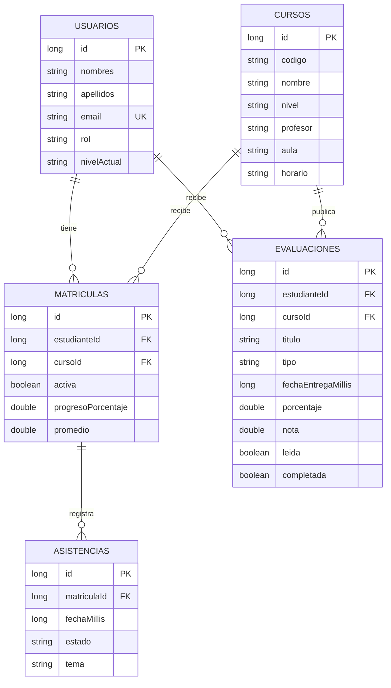
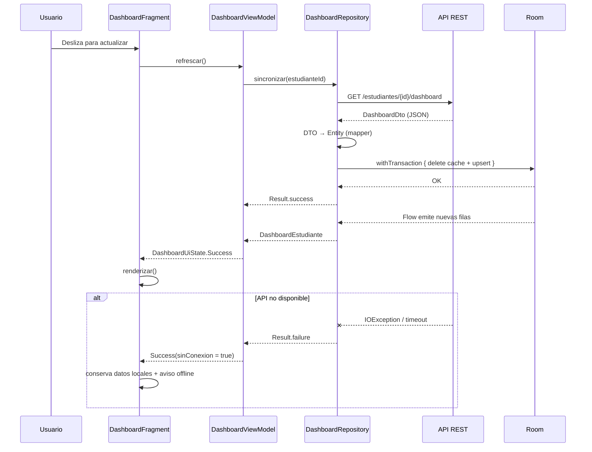

# 10 — Arquitectura de la app Android Anglish

**Complemento móvil:** Anglish Android  
**Tecnología:** Kotlin + XML + ViewBinding + MVVM + Room + Retrofit  
**Paquete:** `com.anglish.app`  
**Incremento:** base técnica y Dashboard del Estudiante

---

## 1. Propósito del documento

Este documento explica cómo está construida la aplicación Android, qué decisiones de arquitectura se tomaron y cómo se relacionan las clases con los requisitos del proyecto web. Sirve como apoyo para la sustentación: cada afirmación de la app se puede ubicar en un archivo concreto.

La app **no modifica** el proyecto PHP/MySQL. Lo complementa y reutiliza su modelo de negocio:

- roles Administrador, Profesor y Estudiante;
- niveles A1–C1;
- escala de notas 1.0–5.0;
- regla de asistencia efectiva;
- alertas académicas por fecha de entrega.

---

## 2. Requisitos cubiertos en este incremento

| Requisito web | Implementación Android |
|---|---|
| RF-01 / RF-02 (sesión y cierre) | `SessionManager` con almacenamiento cifrado. La pantalla de Login se implementa en el siguiente incremento; por ahora existe una sesión de demostración. |
| RF-05 (RBAC) | `Rol` y sesión por rol. El Dashboard actual es el del Estudiante. El servidor seguirá siendo la autoridad de permisos. |
| RF-33 (porcentaje de asistencia) | Agregado SQL en `AsistenciaDao.observarResumen`; la UI solo muestra el resultado. |
| RF-36 (promedio y avance) | `matriculas.promedio` y `matriculas.progresoPorcentaje`, observados con Room. |
| RF-37 / RF-38 (alertas de entregas) | `evaluaciones` no completadas, ordenadas por fecha; cálculo de urgencia en `EvaluacionAlerta`. |
| RF-39 (centro de notificaciones) | Sección “Centro de alertas” del Dashboard; marcar como leída actualiza Room. |
| RF-40 (dashboard por rol) | `DashboardFragment` para Estudiante. El Dashboard del Profesor queda para el siguiente incremento. |

---

## 3. Vista general

```text
┌──────────────────────────────────────────────────────────────┐
│                    CAPA DE PRESENTACIÓN                      │
│  MainActivity                                                │
│  DashboardFragment                                           │
│  EvaluacionAdapter · AsistenciaAdapter                       │
│  XML + ViewBinding                                           │
└───────────────────────────┬──────────────────────────────────┘
                            │ intención del usuario
                            │ y observación de estado
┌───────────────────────────▼──────────────────────────────────┐
│                    CAPA DE PRESENTACIÓN LÓGICA               │
│  DashboardViewModel                                          │
│  DashboardUiState (Loading / Success / Error)                │
│  DashboardEvent (Snackbar)                                   │
└───────────────────────────┬──────────────────────────────────┘
                            │
┌───────────────────────────▼──────────────────────────────────┐
│                    CAPA DE DATOS                             │
│  DashboardRepository                                         │
│  ├── Room: fuente única de verdad para la UI                 │
│  └── Retrofit: sincronización remota                         │
└───────────────┬───────────────────────────────┬──────────────┘
                │                               │
┌───────────────▼──────────────┐  ┌─────────────▼──────────────┐
│ Room / SQLite                │  │ API REST /api/v1           │
│ usuarios, cursos, matrículas  │  │ JSON con Retrofit + Gson   │
│ asistencias, evaluaciones     │  │ Token Bearer en OkHttp     │
└──────────────────────────────┘  └────────────────────────────┘
```

### Principio central: offline-first

La interfaz **nunca** consume Retrofit directamente. El repositorio escribe la respuesta de la API en Room y la UI observa Room. Esto produce tres beneficios:

1. El Dashboard carga sin Internet.
2. No hay dos fuentes de verdad compitiendo.
3. Si la sincronización falla, los datos anteriores permanecen intactos.

---

## 4. Responsabilidades por capa

| Capa | Clases | Responsabilidad | No debe hacer |
|---|---|---|---|
| Dominio | `model/*` | Reglas puras: urgencia, estados, niveles, resumen. | Depender de Android, Room o Retrofit. |
| Presentación | `MainActivity`, `DashboardFragment`, adaptadores, XML | Mostrar estado y capturar eventos. | Consultar la base o la red. |
| Presentación lógica | `DashboardViewModel`, `DashboardUiState` | Orquestar, exponer `StateFlow`, validar estados de carga. | Conocer detalles de SQL o HTTP. |
| Datos | `DashboardRepository`, DAO, API, mappers | Sincronizar, mapear, aplicar reglas de persistencia. | Renderizar o navegar. |
| Sesión | `SessionManager` | Guardar token y datos mínimos cifrados. | Autorizar operaciones por sí solo. |
| Composición | `AnglishApplication`, `AppContainer` | Construir el grafo de dependencias. | Contener lógica de negocio. |

---

## 5. Estructura del código

```text
android/
├── app/src/main/java/com/anglish/app/
│   ├── AnglishApplication.kt
│   ├── MainActivity.kt
│   ├── di/AppContainer.kt
│   ├── model/
│   │   ├── Usuario.kt
│   │   ├── Curso.kt
│   │   ├── Asistencia.kt
│   │   ├── EvaluacionAlerta.kt
│   │   ├── ResumenAsistencia.kt
│   │   ├── DashboardEstudiante.kt
│   │   └── Rol.kt, NivelIngles.kt, EstadoAsistencia.kt,
│   │       TipoEvaluacion.kt, Urgencia.kt
│   ├── data/
│   │   ├── local/
│   │   │   ├── entity/
│   │   │   ├── dao/
│   │   │   ├── model/
│   │   │   ├── Converters.kt
│   │   │   ├── AnglishDatabase.kt
│   │   │   └── seed/DemoDataSeeder.kt
│   │   ├── remote/
│   │   │   ├── dto/
│   │   │   ├── AnglishApiService.kt
│   │   │   ├── AuthInterceptor.kt
│   │   │   ├── DateParser.kt
│   │   │   └── RetrofitClient.kt
│   │   ├── mapper/
│   │   ├── repository/DashboardRepository.kt
│   │   └── session/SessionManager.kt
│   ├── viewmodel/
│   └── ui/
│       ├── common/FechaUi.kt
│       └── dashboard/
├── app/src/main/res/
│   ├── layout/
│   ├── drawable/
│   ├── navigation/
│   ├── values/
│   └── xml/network_security_config.xml
├── app/src/test/
└── README.md
```

---

## 6. Modelo local



### ¿Por qué guardar fechas como `Long`?

SQLite no tiene un tipo fecha nativo. Guardar `epoch millis` permite ordenar eficientemente y evita ambigüedades de zona horaria al persistir. La conversión a `Instant` se hace en los mappers y el formateo en `FechaUi.kt`.

### ¿Por qué `@Upsert` y no `REPLACE`?

`REPLACE` elimina la fila anterior antes de insertar. En una tabla con `ON DELETE CASCADE`, actualizar un usuario podría borrar sus matrículas, asistencias y evaluaciones. `@Upsert` actualiza la fila existente sin disparar cascadas.

---

## 7. Flujo de sincronización



### Detalle de la transacción

`DashboardRepository.sincronizar` hace lo siguiente dentro de `database.withTransaction`:

1. `usuarioDao.upsert(usuario)`.
2. `cursoDao.upsert(curso)`.
3. `matriculaDao.upsert(matricula)`.
4. `asistenciaDao.eliminarPorEstudiante(...)`.
5. `evaluacionDao.eliminarPorEstudiante(...)`.
6. Inserta las asistencias y evaluaciones nuevas.

Si cualquier paso falla, Room revierte todo. Así no queda un estado parcial.

---

## 8. Estado y eventos en el ViewModel

```kotlin
sealed interface DashboardUiState {
    data object Loading : DashboardUiState
    data class Success(
        val dashboard: DashboardEstudiante,
        val refrescando: Boolean,
        val sinConexion: Boolean
    ) : DashboardUiState
    data class Error(val mensaje: String) : DashboardUiState
}
```

- **Loading:** se muestra mientras Room aún no entrega el primer registro.
- **Success:** contiene un modelo inmutable; la vista solo pinta.
- **Error:** se usa si el flujo de Room falla.
- **`refrescando`:** controla el `SwipeRefreshLayout`.
- **`sinConexion`:** muestra el aviso de modo offline sin ocultar los datos.

Los mensajes de una sola vez se modelan con `DashboardEvent` y se emiten por `SharedFlow`. No se guardan en el estado porque un `Snackbar` no debe reaparecer al rotar la pantalla.

---

## 9. Cálculo de urgencia

Está en `model/EvaluacionAlerta.kt`:

```kotlin
fun urgencia(ahora: Instant = Instant.now()): Urgencia {
    if (!fechaEntrega.isAfter(ahora)) return Urgencia.VENCIDA
    val horasRestantes = Duration.between(ahora, fechaEntrega).toHours()
    return when {
        horasRestantes < 24 -> Urgencia.HOY
        horasRestantes <= 48 -> Urgencia.PROXIMA
        else -> Urgencia.NORMAL
    }
}
```

Ventajas:

- Es una regla de negocio, no un `if` dentro del adaptador.
- Recibe `ahora` por parámetro, por lo que la prueba es determinista.
- La vista solo traduce el enum a color y texto.

La prueba `EvaluacionAlertaTest` valida los cuatro casos.

---

## 10. Sesión y seguridad

### Almacenamiento

`SessionManager` usa `EncryptedSharedPreferences` con una clave maestra AES-256 del Android Keystore. Guarda:

- ID del usuario;
- nombres y apellidos;
- correo;
- rol;
- nivel actual;
- token.

### Decisiones

- Un rol inválido se interpreta como `ESTUDIANTE` (menor privilegio).
- El token se adjunta con `AuthInterceptor` como `Authorization: Bearer ...`.
- El logging de OkHttp está activo solo en debug y oculta el header.
- `network_security_config.xml` permite HTTP únicamente para el emulador y localhost.
- La app no autoriza por sí sola: el backend debe validar token y permisos.

### Limitación académica

La sesión de demostración se crea automáticamente para poder abrir el Dashboard antes de implementar Login. En producción se elimina `asegurarSesionDemo()` y la navegación inicia en el Login.

---

## 11. Interfaz y accesibilidad

- **ViewBinding:** evita `findViewById` y errores por IDs.
- **Material 3:** tarjetas, chips, progreso circular y botones.
- **Edge-to-edge:** `MainActivity` aplica los insets de barras del sistema para que targetSdk 37 no tape contenido.
- **Contenido descriptivo:** iconos y tarjetas de alerta tienen `contentDescription`.
- **Estados vacíos:** la lista de alertas y la de asistencias muestran un mensaje cuando no hay datos.
- **Colores:** rojo para vencida/≤24 h, ámbar para ≤48 h, verde para programada; además del color, se muestra una etiqueta textual para no depender solo del color.

---

## 12. Evidencia de compilación y pruebas

Comandos usados:

```powershell
.\gradlew.bat :app:assembleDebug
.\gradlew.bat :app:testDebugUnitTest
.\gradlew.bat :app:lintDebug
```

Resultado:

- `assembleDebug`: **BUILD SUCCESSFUL**.
- `testDebugUnitTest`: **4 pruebas aprobadas**.
- `lintDebug`: **BUILD SUCCESSFUL**; solo quedan advertencias informativas de versiones disponibles y una de la carpeta `mipmap-anydpi-v26`.
- APK generado en `android/app/build/outputs/apk/debug/app-debug.apk`.

La ejecución en emulador no fue posible en el equipo de compilación porque el Android Emulator Hypervisor Driver no está instalado. La app sí compila, pasa lint y pruebas unitarias; para la demostración se debe abrir en Android Studio con un emulador o dispositivo físico.

---

## 13. Decisiones y justificación para la sustentación

| Pregunta probable | Respuesta |
|---|---|
| ¿Por qué no se usa la API directamente en el Fragment? | Porque se duplicaría el estado y el Dashboard fallaría sin Internet. Room es la fuente única y la API solo sincroniza. |
| ¿Por qué no Hilt? | El proyecto es académico y el grafo es pequeño; `AppContainer` demuestra la inyección manual y es más fácil de explicar. |
| ¿Por qué Room y no solo SharedPreferences? | Se necesitan relaciones, consultas agregadas, ordenamientos y actualizaciones reactivas. Room ofrece SQLite tipado y `Flow`. |
| ¿Por qué KSP y no kapt? | KSP es más rápido y es el procesador recomendado para Room en versiones actuales. |
| ¿Por qué `StateFlow` y no `LiveData`? | Se trabaja con corrutinas y `Flow`; `StateFlow` ofrece un estado observable con valor inicial y se integra con `repeatOnLifecycle`. |
| ¿Cómo se evita que una respuesta vacía borre datos? | Se valida el estudiante y la matrícula; la transacción solo reemplaza asistencias/evaluaciones cuando hay curso y matrícula válidos. |
| ¿Cómo se garantiza que el color no sea la única señal? | Cada alerta muestra una etiqueta textual: “Vencida”, “≤ 24 h”, “≤ 48 h” o “Programada”. |
| ¿Qué pasa si la API no existe todavía? | La app conserva la semilla de Room y muestra “Modo offline”; no se bloquea la interfaz. |

---

## 14. Siguiente incremento

1. `LoginFragment` + autenticación real contra `POST /auth/login`.
2. Navegación condicional por rol: Dashboard Estudiante / Dashboard Profesor.
3. Pantalla completa de Asistencia con historial y filtros.
4. Pantalla completa de Alertas con acciones de lectura y detalle.
5. Pruebas instrumentadas de Room y de la navegación.
6. WorkManager para sincronización periódica.
7. Migraciones Room y eliminación de `fallbackToDestructiveMigration`.
